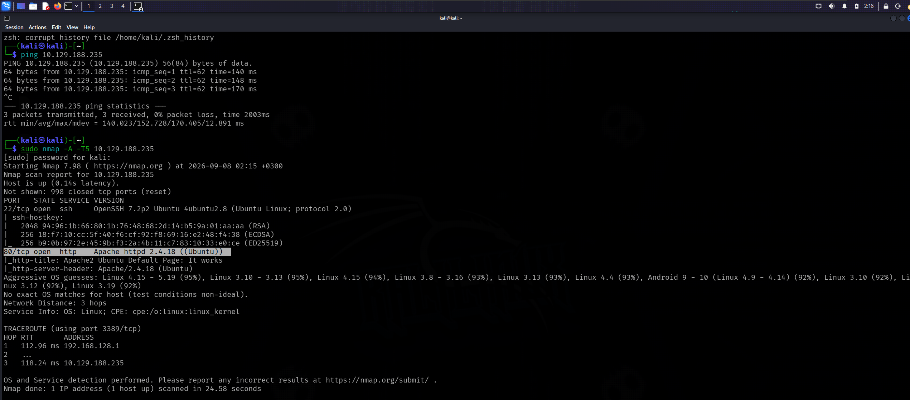

# 01 — Reconnaissance

## Overview

Reconnaissance is the first phase of the engagement: confirming the target is reachable, then identifying open ports, running services, and their versions. This page documents the recon performed against the lab target `10.129.188.235`.

## Objectives

- Confirm the host is alive and reachable.
- Identify open TCP ports.
- Identify running services and their versions.
- Gather OS fingerprinting clues.
- Establish a baseline attack surface before deeper enumeration.

## Important Terminology

| Term | Definition |
|---|---|
| Host discovery | Determining whether a target IP is online and responding |
| Port scan | Probing a range of ports to determine open, closed, or filtered state |
| Service/version detection | Identifying the software and version bound to an open port |
| OS fingerprinting | Inferring the target operating system from TCP/IP stack behavior |
| TTL (Time To Live) | An IP header field whose value in a ping reply can hint at the remote OS |

## Concepts Explained

Before running any noisy scans, it's good practice to confirm basic connectivity with `ping`. This validates routing and reachability, and the TTL value in the reply gives an early clue about the OS — Linux targets commonly reply with a TTL near 64, Windows near 128, reduced by the number of network hops in transit.

Once reachability is confirmed, an aggressive Nmap scan (`-A`) combines OS detection, version detection, script scanning, and traceroute into a single pass. This is convenient in a lab environment where scan noise and timing aren't a concern. On a real engagement, this would typically be split into a fast, quiet initial scan followed by a targeted, more aggressive one.

## Commands and Syntax

### Host discovery

**Purpose:** Confirm the target is online before scanning.

**Syntax:**
```bash
ping <target>
```

**Why it was used:** A quick sanity check that the lab target was up before spending time on a full port scan.

**Example (executed):**
```bash
ping 10.129.188.235
```

**Observed result:**
```text
PING 10.129.188.235 (10.129.188.235) 56(84) bytes of data.
64 bytes from 10.129.188.235: icmp_seq=1 ttl=62 time=140 ms
64 bytes from 10.129.188.235: icmp_seq=2 ttl=62 time=148 ms
64 bytes from 10.129.188.235: icmp_seq=3 ttl=62 time=170 ms
^C
--- 10.129.188.235 ping statistics ---
3 packets transmitted, 3 received, 0% packet loss, time 2003ms
rtt min/avg/max/mdev = 140.023/152.728/170.405/12.891 ms
```

> [!NOTE]
> A TTL of 62 is consistent with a Linux host reachable two hops from a default TTL of 64, matching the OS detection results below.

### Aggressive Nmap scan

**Purpose:** Perform OS detection, version detection, default script scanning, and traceroute in a single scan.

**Syntax:**
```bash
sudo nmap -A -T5 <target>
```

**Why it was used:** To get a comprehensive first-pass picture of open ports, service versions, and OS in one command — appropriate for a lab environment with no need for stealth.

**Example (executed):**
```bash
sudo nmap -A -T5 10.129.188.235
```

**Observed result:**
```text
Starting Nmap 7.98 ( https://nmap.org ) at 2026-09-08 02:15 +0300
Nmap scan report for 10.129.188.235
Host is up (0.14s latency).
Not shown: 998 closed tcp ports (reset)
PORT   STATE SERVICE VERSION
22/tcp open  ssh     OpenSSH 7.2p2 Ubuntu 4ubuntu2.8 (Ubuntu Linux; protocol 2.0)
| ssh-hostkey:
|   2048 94:96:1b:66:80:1b:76:48:68:2d:14:b5:9a:01:aa:aa (RSA)
|   256 18:f7:10:cc:5f:40:f6:cf:92:f8:69:16:e2:48:f4:38 (ECDSA)
|_  256 b9:0b:97:2e:45:9b:f3:2a:4b:11:c7:83:10:33:e0:ce (ED25519)
80/tcp open  http    Apache httpd 2.4.18 ((Ubuntu))
|_http-title: Apache2 Ubuntu Default Page: It works
|_http-server-header: Apache/2.4.18 (Ubuntu)
Aggressive OS guesses: Linux 4.15 - 5.19 (95%), Linux 3.10 - 3.13 (95%), Linux 4.15 (94%), Linux 3.8 - 3.16 (93%), Linux 3.13 (93%), Linux 4.4 (93%), Android 9 - 10 (Linux 4.9 - 4.14) (92%), Linux 3.10 (92%), Linux 3.12 (92%), Linux 3.19 (92%)
No exact OS matches for host (test conditions non-ideal).
Network Distance: 3 hops
Service Info: OS: Linux; CPE: cpe:/o:linux:linux_kernel

TRACEROUTE (using port 3389/tcp)
HOP RTT      ADDRESS
1   112.96 ms 192.168.128.1
2   ...
3   118.24 ms 10.129.188.235

OS and Service detection performed. Please report any incorrect results at https://nmap.org/submit/ .
Nmap done: 1 IP address (1 host up) scanned in 24.58 seconds
```

## Command Breakdown

| Command | Flag | Description |
|---|---|---|
| `ping` | `<target>` | Destination IP address or hostname |
| `nmap` | `-A` | Enables OS detection, version detection, script scanning, and traceroute |
| `nmap` | `-T5` | Sets timing template to "Insane" — the fastest, most aggressive timing (lab use only) |
| `nmap` | `sudo` (prefix) | Required for the raw-socket operations used by OS fingerprinting |

## Examples

The `ping` and `nmap` commands under [Commands and Syntax](#commands-and-syntax) above are the full set of commands executed during this phase; no additional examples were captured.

## Screenshots

| Screenshot | Description |
|---|---|
|  | Terminal output of `ping` followed by the aggressive Nmap scan, showing ports 22 and 80 open |

## Observations

| Port | Service | Version | Notes |
|---|---|---|---|
| 22/tcp | ssh | OpenSSH 7.2p2 (Ubuntu) | Three host keys presented (RSA, ECDSA, ED25519) |
| 80/tcp | http | Apache httpd 2.4.18 (Ubuntu) | Serving the default "It works" Apache page, suggesting real content lives elsewhere |

- Only two ports were open, giving a small and focused attack surface.
- The default Apache landing page strongly suggests hidden or undocumented content rather than a finished site — a signal to move into web directory enumeration.
- The OS fingerprint is inconclusive on exact kernel version but confidently identifies the target as Linux.

## Common Mistakes

- Skipping host discovery and going straight to a full scan, wasting time if the host is down or ICMP is filtered.
- Relying only on `-A`'s default script set and never following up with targeted NSE scripts for the discovered services.
- Treating a default "It works" page as a dead end instead of a cue to enumerate further.
- Using `-T5` outside of a lab or CTF context — it is loud and can cause instability against real targets.

## Notes

- This scan required `sudo` because OS fingerprinting relies on raw socket privileges.
- `-T5` was safe here because the target is an isolated lab machine, not a production system.

## Additional Context

> [!NOTE]
> Supplementary knowledge, not directly observed during this session.

Nmap's `-A` flag is a convenience flag equivalent to combining `-O` (OS detection), `-sV` (version detection), `-sC` (default script scan), and `--traceroute`. On a real engagement, it is common to first run a fast scan across all 65,535 ports (`-p-`) to make sure nothing was missed by the default top-1000 port list, then follow up with `-A` or targeted `-sC -sV` scans against only the ports found open.

## References

- [Nmap Reference Guide](https://nmap.org/book/man.html)
- [Nmap NSE Documentation](https://nmap.org/nsedoc/)

## Key Takeaways

- Two open ports (SSH, HTTP) define the entire initial attack surface.
- A default Apache page is a signal, not a dead end — it points toward web content discovery as the next step.
- Always capture host key fingerprints and version banners; they matter later, for example when confirming a recovered SSH key belongs to this host.

**Next:** [02 — Enumeration →](../02-Enumeration/README.md)
