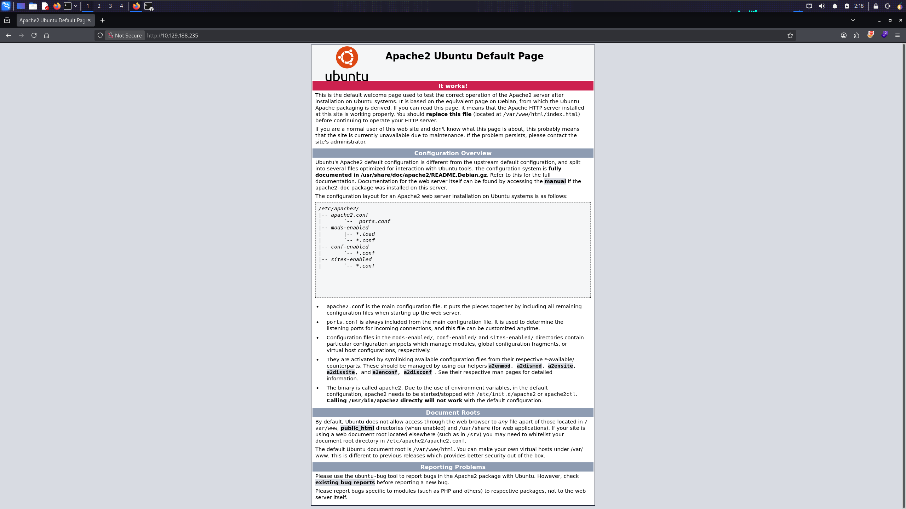
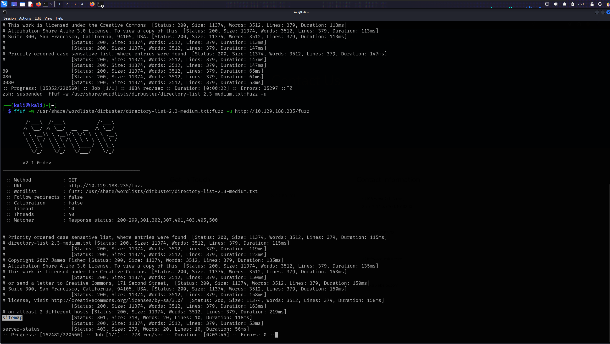
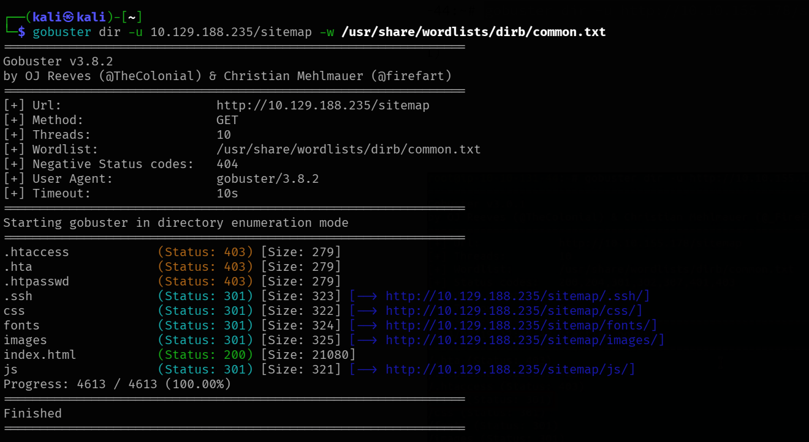
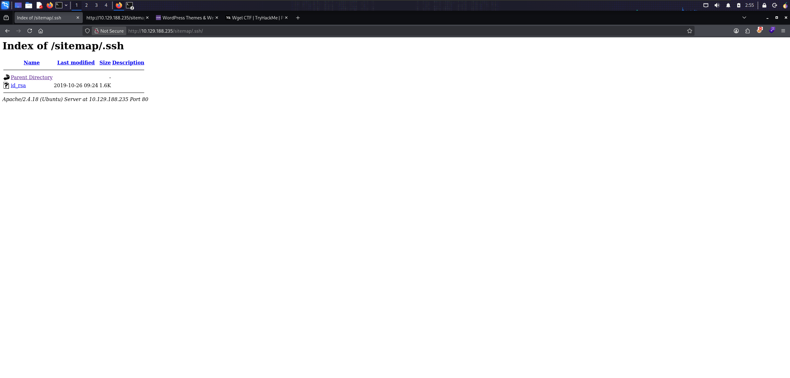

# 03 — Web Enumeration

## Overview

This phase covers manual browsing and automated content discovery against the HTTP service on port 80. It produced the engagement's key breakthrough: a brute-forced directory led to a nested, unlinked `.ssh` folder exposed by the web server.

## Objectives

- Manually confirm the default Apache page in a browser.
- Brute-force hidden directories and files at the web root.
- Recursively investigate any discovered directory.
- Identify misconfigurations that expose sensitive files.

## Important Terminology

| Term | Definition |
|---|---|
| Directory brute-forcing (fuzzing) | Systematically requesting a wordlist of candidate paths against a web server to find unlinked content |
| Wordlist | A file of candidate strings, such as directory or file names, used to drive a fuzzing tool |
| Directory listing | A web server feature that renders a raw file listing when no index file is present and listing is enabled |
| Recursive enumeration | Re-running a fuzzer against directories discovered by a previous run, to find nested content |
| Negative status codes | HTTP status codes, such as 404, used to filter out "not found" noise from fuzzing results |

## Concepts Explained

Directory brute-forcing works by sending a request for every entry in a wordlist as a candidate path and observing the response — status code, size, and word or line count. Responses that deviate from the "not found" baseline indicate real content.

Two tools were used here for complementary reasons:

1. **`ffuf`** — fast and flexible, used for an initial wide sweep with the `FUZZ` keyword placeholder.
2. **`gobuster`** — used for a focused, recursive pass into a directory `ffuf` had already flagged (`/sitemap`), against a smaller, high-signal wordlist.

This two-pass pattern — a broad sweep followed by a focused, recursive sweep — is a common and efficient enumeration workflow: let each result narrow the next step rather than running every tool against everything.

## Commands and Syntax

### Manual verification in browser

Before fuzzing, the homepage and an already-known path were reviewed manually in Firefox:

- `http://10.129.188.235/` returned the stock Apache2 Ubuntu default page.
- `http://10.129.188.235/sitemap/` returned an "unapp" HTML template, a finance-dashboard-style demo site — confirming real, non-default content living outside the homepage.

### Initial fuzz sweep with ffuf

**Purpose:** Discover hidden top-level directories and files not linked from the homepage.

**Syntax:**
```bash
ffuf -w <wordlist>:FUZZ -u http://<target>/FUZZ
```

**Why it was used:** Fast, wide coverage across a large wordlist to surface non-default paths before investigating manually.

**Example (executed):**
```bash
ffuf -w /usr/share/wordlists/dirbuster/directory-list-2.3-medium.txt:fuzz -u http://10.129.188.235/fuzz
```

**Observed result (excerpt):**
```text
:: Method           : GET
:: URL              : http://10.129.188.235/fuzz
:: Wordlist         : fuzz: /usr/share/wordlists/dirbuster/directory-list-2.3-medium.txt
:: Follow redirects : false
:: Calibration      : false
:: Timeout          : 10
:: Threads          : 40
:: Matcher          : Response status: 200-299,301,302,307,401,403,405,500

sitemap                 [Status: 301, Size: 318, Words: 20, Lines: 10, Duration: 118ms]
server-status           [Status: 403, Size: 279, Words: 20, Lines: 10, Duration: 56ms]
:: Progress: [162482/220560] :: Job [1/1] :: 778 req/sec :: Duration: [0:03:45] :: Errors: 0
```

> [!TIP]
> A `301` response for `sitemap` — a redirect, typically to `sitemap/` — combined with it not being a default Apache path made it the obvious next target for a focused, recursive scan.

### Focused recursive scan with gobuster

**Purpose:** Enumerate the contents of the newly discovered `/sitemap` directory in more depth, including hidden dotfiles.

**Syntax:**
```bash
gobuster dir -u <url> -w <wordlist>
```

**Why it was used:** `.htaccess` and `.htpasswd` returning `403` confirmed the server actively blocks some sensitive paths, which made the `301` on `.ssh` stand out immediately as not being blocked the same way.

**Example (executed):**
```bash
gobuster dir -u 10.129.188.235/sitemap -w /usr/share/wordlists/dirb/common.txt
```

**Observed result:**
```text
Gobuster v3.8.2
by OJ Reeves (@TheColonial) & Christian Mehlmauer (@firefart)
===============================================================
[+] Url:                     http://10.129.188.235/sitemap
[+] Method:                  GET
[+] Threads:                 10
[+] Wordlist:                /usr/share/wordlists/dirb/common.txt
[+] Negative Status codes:   404
[+] User Agent:               gobuster/3.8.2
[+] Timeout:                 10s
===============================================================
Starting gobuster in directory enumeration mode
===============================================================
.htaccess              (Status: 403) [Size: 279]
.hta                    (Status: 403) [Size: 279]
.htpasswd               (Status: 403) [Size: 279]
.ssh                     (Status: 301) [Size: 323] [--> http://10.129.188.235/sitemap/.ssh/]
css                      (Status: 301) [Size: 322] [--> http://10.129.188.235/sitemap/css/]
fonts                    (Status: 301) [Size: 324] [--> http://10.129.188.235/sitemap/fonts/]
images                   (Status: 301) [Size: 325] [--> http://10.129.188.235/sitemap/images/]
index.html               (Status: 200) [Size: 21080]
js                       (Status: 301) [Size: 321] [--> http://10.129.188.235/sitemap/js/]
Progress: 4613 / 4613 (100.00%)
===============================================================
Finished
===============================================================
```

> [!WARNING]
> `.ssh` returning a `301` (redirect to a trailing-slash directory listing) rather than `403 Forbidden` is a critical finding — it means the web server is serving the contents of an SSH configuration directory, which should never be reachable over HTTP.

## Command Breakdown

| Command | Flag | Description |
|---|---|---|
| `ffuf` | `-w <wordlist>:FUZZ` | Loads the wordlist and binds it to the `FUZZ` keyword |
| `ffuf` | `-u http://<target>/FUZZ` | Target URL template; `FUZZ` is substituted with each wordlist entry |
| `gobuster` | `dir` | Directory and file enumeration mode |
| `gobuster` | `-u <url>` | Target base URL to enumerate |
| `gobuster` | `-w <wordlist>` | Wordlist used to generate candidate paths |

## Examples

Browsing directly to the exposed directory confirmed the finding and revealed a private key file inside it:

```text
Index of /sitemap/.ssh
Name        Last modified        Size  Description
Parent Directory                 -
id_rsa      2019-10-26 09:24    1.6K
```

This is documented further in [05 — Credentials](../05-Credentials/README.md).

## Screenshots

| Screenshot | Description |
|---|---|
|  | Stock Apache2 Ubuntu default landing page |
|  | Unlinked demo template served at `/sitemap/` |
|  | Wide `ffuf` sweep surfacing `/sitemap` |
|  | Recursive `gobuster` scan of `/sitemap` surfacing `.ssh` |
|  | Directory listing exposing `id_rsa` |

## Observations

- The web root's homepage is the default Apache page, but a real, if unfinished-looking, HTML template lives at `/sitemap/`, discoverable only through brute-forcing.
- Directory listing is enabled for at least the `/sitemap/` subtree — browsing to a directory without an `index.html`, such as `.ssh/`, renders a raw file listing instead of a 403/404 response.
- A `.ssh` directory, normally a hidden, restricted local user directory, was placed inside the web root and is fully browsable and downloadable over plain HTTP.
- This is a textbook sensitive file exposure vulnerability: no authentication, encryption, or access control stood between an anonymous web request and private key material.

## Common Mistakes

- Running only one wordlist or tool and stopping — the `.ssh` folder was only found on the second, more targeted pass.
- Not distinguishing `403` from `301` responses — treating everything non-200 as a dead end.
- Forgetting to recursively re-scan discovered directories for nested content.
- Downloading and using sensitive files found this way without first confirming authorization within the scope of the engagement.

## Notes

- `dirb/common.txt` is a smaller, curated wordlist and was effective here because the exposed content (`.ssh`, `css`, `js`, `fonts`, `images`) used common, guessable names.

## Additional Context

> [!NOTE]
> Supplementary information, not directly observed during this session.

This class of bug is frequently caused by a developer copying an entire home directory, including `.ssh`, into a web-servable path during deployment or testing and forgetting to remove it. Real-world equivalents include exposed `.git/` directories, `.env` files, and backup archives (`.zip`, `.tar.gz`, `.bak`) left in web roots — all discoverable through the same directory brute-forcing methodology shown above.

## References

- [ffuf GitHub](https://github.com/ffuf/ffuf)
- [gobuster GitHub](https://github.com/OJ/gobuster)
- [OWASP — Testing for Exposed Sensitive Files](https://owasp.org/www-project-web-security-testing-guide/)
- [SecLists (common wordlists)](https://github.com/danielmiessler/SecLists)

## Key Takeaways

- A default or placeholder homepage is a strong indicator that real content is hidden — always fuzz.
- Layer enumeration: a broad sweep to find entry points, then focused recursive sweeps into anything interesting.
- `403` versus `301`/`200` on sensitive-looking paths shows whether a protection is actually working — don't assume.
- Directory listing combined with a misplaced `.ssh` folder is a complete, silent compromise path requiring no exploit code.

**Previous:** [← 02 — Enumeration](../02-Enumeration/README.md) · **Next:** [05 — Credentials →](../05-Credentials/README.md)
